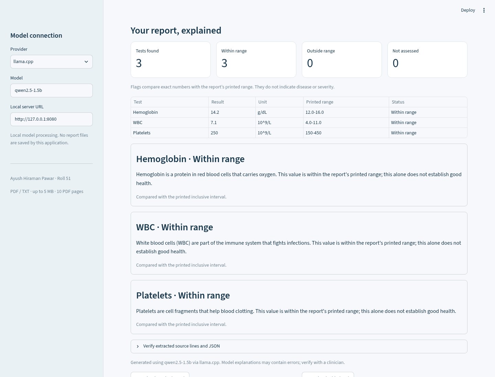
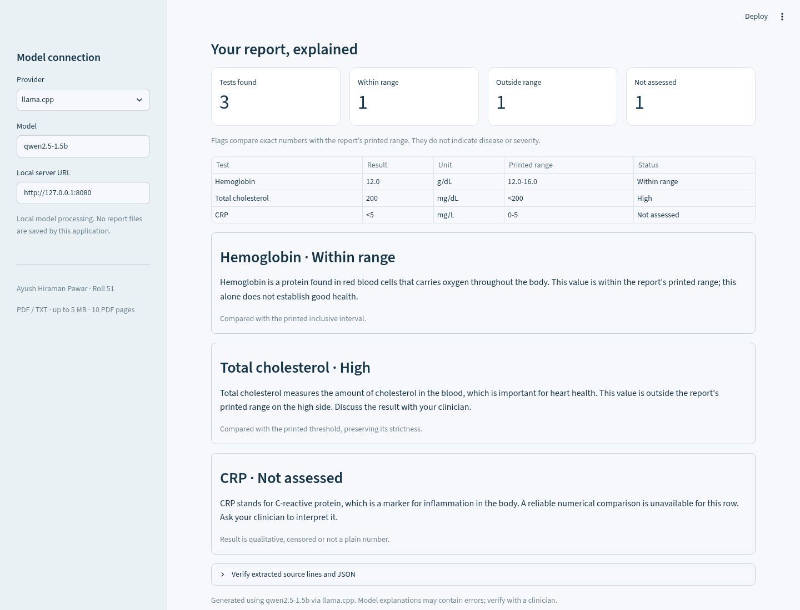

# Medical Report Explainer — PS 51

A Streamlit mini project that extracts laboratory tests from PDF/text using an LLM, checks the printed reference ranges with Python, and explains each test in simple words.

**Student:** Ayush Hiraman Pawar  
**Roll:** 51 · **Enrollment:** ADT24SOCBD036 · **Class:** LY Core 2

> Not medical advice — consult a doctor. A flag is a numerical comparison with the report's printed range, not a diagnosis. Check the extracted rows against the original report.

## Start here

- [Two-page procedure report](submission/Report.pdf)
- [Complete code ZIP](submission/Code.zip)
- [All submission files](submission/Submission_PS51_Ayush_Hiraman_Pawar.zip)
- [Five output screenshots](screenshots/)
- [Viva preparation](docs/VIVA.md)
- [Actual local-model evaluation](evidence/summary.json)

## Problem statement

Patients may find blood-test reports difficult to understand. Upload a report as PDF or text; an LLM extracts test/value/unit/range rows as JSON, Python flags values outside the printed range, and a second LLM call explains each test with a disclaimer. No model training is required.

## Run locally (recommended: Ollama)

Use Python 3.12 or newer. Install [Ollama](https://ollama.com/download), then:

```bash
ollama pull qwen2.5:1.5b
```

Keep Ollama running (`ollama serve` if it is not already running). In a separate terminal:

```bash
git clone https://github.com/ayush-h-pawar/llm-ps51-51.git
cd llm-ps51-51
python -m venv .venv
```

Activate the environment:

```bash
# Windows PowerShell
.venv\Scripts\Activate.ps1
# macOS / Linux
source .venv/bin/activate
```

Then install and start:

```bash
python -m pip install -r requirements.txt
python -m streamlit run app.py
```

Open the localhost address shown in the terminal. Select **Ollama**, keep model `qwen2.5:1.5b` and URL `http://127.0.0.1:11434`, choose a sample, and click **Explain report**. The model download is roughly 1 GB and runs on CPU; a larger model may improve explanation quality. Internet access is needed to install packages and download the model, but local inference can then run offline.

### Optional: Groq API

Select **Groq**, enter your own API key in the password field, and use a model supported by your account (default `llama-3.3-70b-versatile`). Remove identifying details and tick the consent checkbox. Provider model names, availability and rate limits can change. Keys are not bundled or saved by the app. This adapter has protocol tests; the included live evidence uses the local model, not Groq.

### Reproduce the tested llama.cpp setup

The recorded runs use [llama.cpp build b12503](https://github.com/ggml-org/llama.cpp/releases/tag/b12503) and [Qwen2.5-1.5B-Instruct Q4_K_M GGUF](https://huggingface.co/Qwen/Qwen2.5-1.5B-Instruct-GGUF). Download a binary suitable for your OS and the file `qwen2.5-1.5b-instruct-q4_k_m.gguf`. The large model weights are intentionally excluded from this repository.

```bash
llama-server -m qwen2.5-1.5b-instruct-q4_k_m.gguf --alias qwen2.5-1.5b --host 127.0.0.1 --port 8080 -c 8192 -t 4 -np 1
```

In the app select **llama.cpp**, model `qwen2.5-1.5b`, URL `http://127.0.0.1:8080`. The app's default is Ollama for simpler installation. Both servers must run on the same computer as Streamlit for the default localhost URLs to work.

## Workflow and design

```text
PDF / TXT / pasted report
  -> text extraction (pypdf for PDF)
  -> LLM call 1: structured test rows
  -> JSON/schema and source-line validation (table cells checked in Python)
  -> Python Decimal range comparisons
  -> LLM call 2: test meanings (names only); Python appends fixed flag explanations
  -> table, explanation cards, JSON / CSV downloads
```

- Inclusive ranges such as `12.0-16.0`, `4,000-11,000`, and thresholds such as `<200`, `<=200`, `>5`, `>=5` are supported.
- Missing ranges, qualitative results, censored values such as `<5`, multiple demographic ranges, incompatible range text and reversed intervals are **Not assessed**.
- For a recognised `Test | Result | Unit | Reference range` table, Python verifies the LLM-extracted name and value, then takes the unit and range directly from the matching printed cells. Corrections are recorded in `validation_notes`. Every table row must be present.
- No reference intervals are invented, no units are converted and no diagnostic severity is assigned.
- Invalid JSON, untraceable source fields and extraction errors stop processing. If only the explanation step fails, the valid numerical results remain visible with a warning.
- Editing the input hides stale results. CSV text is escaped to prevent spreadsheet formula execution.
- Two prompts are in `prompts.py`. Prompt improvement: copy fields exactly, trace them to a unique source line in Python, and preserve comparator signs instead of a free-form summary.

## Tests and real sample results

```bash
python -m pip install -r requirements-dev.txt
python -m pytest -q
# With the local llama.cpp server running:
python evaluate.py
# Alternative local provider:
python evaluate.py --provider Ollama --model qwen2.5:1.5b --base-url http://127.0.0.1:11434
```

Validation completed: **45 automated checks passed**, and **all five live model samples (12 test rows) matched their expected flags**.

The `evidence/` JSON files record real model outputs, expected flags, elapsed time and UTC timestamps. They are synthetic teaching examples, not patient records. A later model run may use different wording.

| Sample | Expected result |
|---|---|
| 01 normal | Three values within printed ranges |
| 02 low | Hemoglobin and ferritin low |
| 03 high | Fasting glucose and total cholesterol high |
| 04 missing range | Missing-range and qualitative results not assessed |
| 05 boundaries | Lower endpoint within range; 200 outside `<200`; `<5` not assessed |




## Files

- `app.py`: Streamlit UI and exports
- `core.py`: file parsing, JSON validation, source checks, comparisons and pipeline
- `llm.py`: Ollama, Groq and llama.cpp HTTP adapters
- `prompts.py`: complete extraction and explanation prompts
- `samples/`: five synthetic TXT reports and a text-based PDF
- `tests/`: numerical, input, provider and UI checks
- `evaluate.py`: five-input live model evaluation
- `evidence/`: observed model results and testing record
- `docs/`: viva notes and reproducibility details
- `submission/`: packaged assignment files

## Limits and privacy

Use reports of at most 5 MB, 10 PDF pages and 14,000 characters. Scanned/image PDFs require external OCR. Long or complex tables can be omitted or misassociated by the model. Exact-source validation reduces invented data but does not prove extraction completeness or correct clinical interpretation. A small general model is not medically validated. Do not use the app for diagnosis, medication decisions or emergencies.

No reports or keys are written to an application database. Streamlit keeps current inputs/results in session memory. Groq mode sends the report to Groq; local modes send it to the configured local server. Operators of those servers may have their own logging settings. Keep this student demo bound to localhost and use synthetic/de-identified reports.
